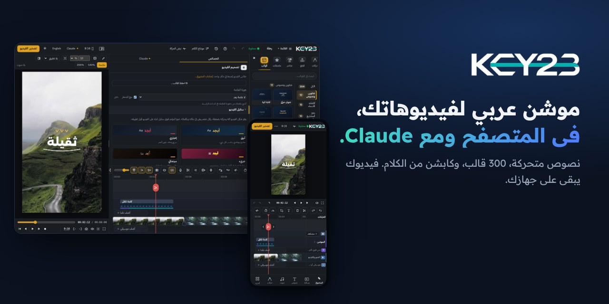
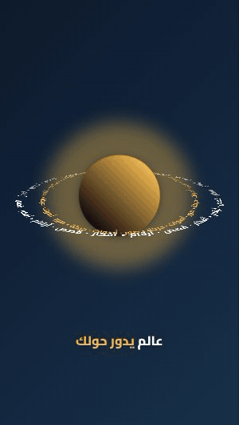
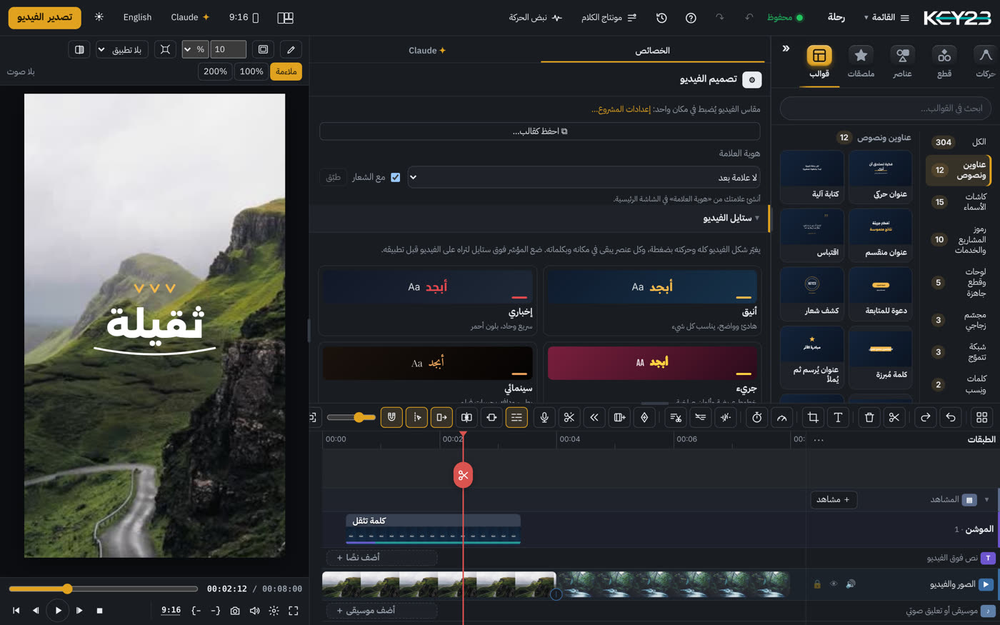
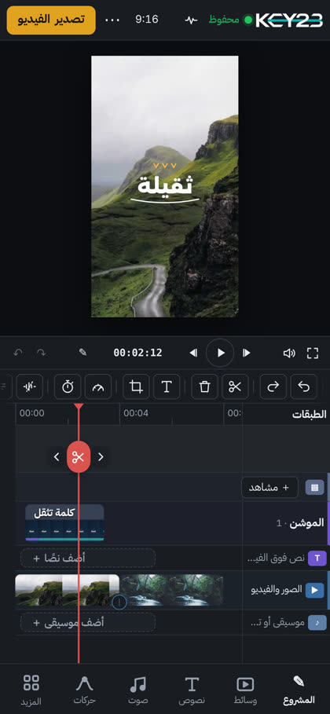
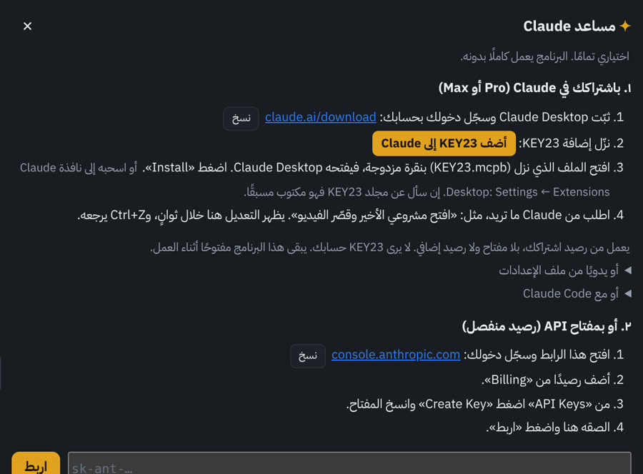
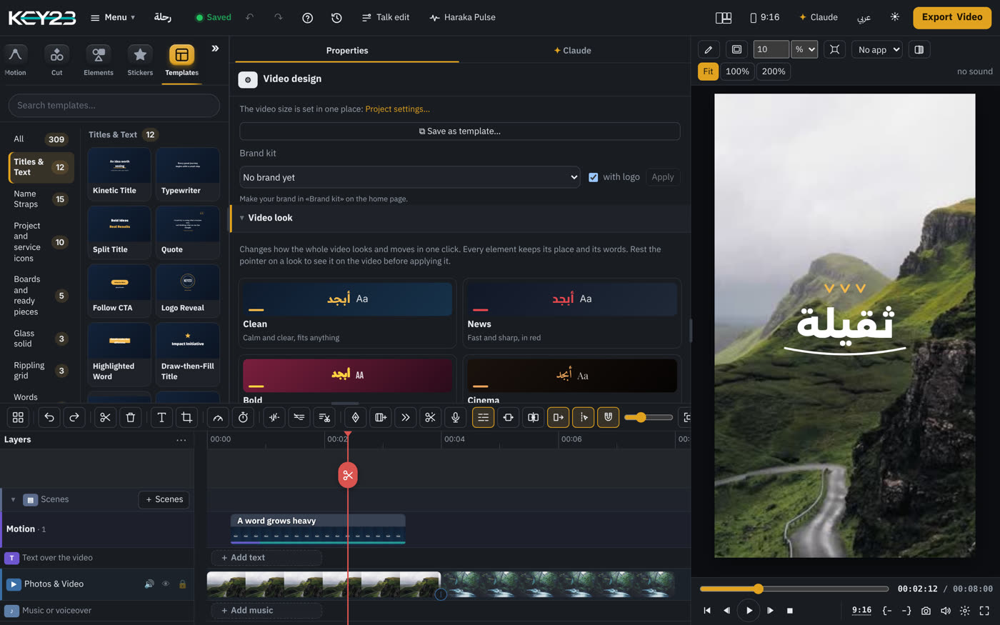
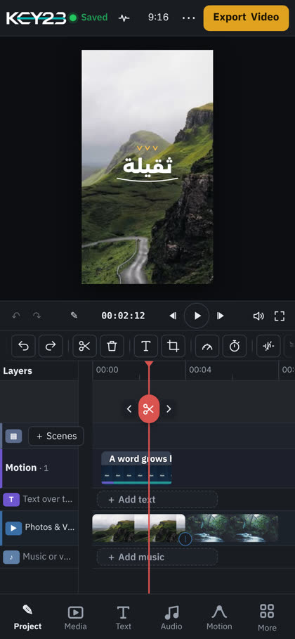

<p align="center"></p>

<div dir="rtl">

# KEY23

استوديو موشن عربي: نصوص متحركة، قوالب، وكابشن تلقائي من الكلام. فيديوك يبقى على جهازك.

- **جرّبه الآن في المتصفح، على الكمبيوتر والهاتف:** [thekey23.com](https://thekey23.com). بلا تسجيل وبلا تثبيت.
- **مشكلة أو فكرة:** [اكتبها هنا](https://github.com/key23studio/haraka/issues/new/choose).

## ما تصنعه

كل هذه قوالب حقيقية في مكتبة KEY23، رسمها البرنامج نفسه. اختر القالب، وغيّر الكلمة واللون والتوقيت.

</div>

<table><tr><td align="center" width="33%"><br><b>بكسلات تبني الكلمة</b></td><td align="center" width="33%"><br><b>شريط ضوء يلفّك</b></td><td align="center" width="33%"><br><b>كلمات حول رأسك</b></td></tr><tr><td align="center" width="33%"><br><b>شاشة بودكاست</b></td><td align="center" width="33%"><br><b>صورة بوسوم</b></td><td align="center" width="33%"><br><b>فقرات على قوس</b></td></tr><tr><td align="center" width="33%"><br><b>غلاف مجلة</b></td><td align="center" width="33%"><br><b>ستيكر</b></td><td align="center" width="33%"><br><b>كلمة تثقل</b></td></tr><tr><td align="center" width="33%"><br><b>كلمات في مدار</b></td><td align="center" width="33%"><br><b>كوفي مربع</b></td><td align="center" width="33%"><br><b>نقاط تنزل</b></td></tr></table>

<div dir="rtl">

## اطلب من Claude

بعد ربط KEY23 بـ Claude (الخطوات تحت)، اكتب طلبك بالكلام:

| اطلب من Claude | ماذا يفعل |
|---|---|
| «احذف الجمل المكررة والبدايات الخاطئة» | يقص من الفيديو، والكابشن يتبع (cut_video) |
| «صحّح كلمات الكابشن الخطأ» | يصحّح الكلمات ويبقي توقيتها (fix_captions) |
| «ترجم الكابشن إلى الإنجليزية» | ترجمة على جهازك، بلا رفع (translate_captions) |
| «قرّب الصورة على الكلمات المهمة» | تقريب ناعم على الوجه عند كل كلمة (word_zoom) |
| «أعطِ الفيديو كله شكلًا إخباريًا» | ألوان وخطوط وحركات وكابشن بشكل واحد (apply_look) |
| «ضع لقطة توضيحية فوق الكلام» | مقطع من مقاطعك فوق الكلام والصوت مستمر (add_broll) |
| «ضع مؤثرات صوتية» | صوت قصير عند كل عنصر وكل قطع (place_sound_effects) |
| «اجعل الموسيقى بطول الفيديو» | يمدّ الموسيقى أو يقصّرها بلا قفزة (fit_music) |
| «اصنع ريلز من هذا النص» | مشروع جديد: مشهد متحرك لكل سطر، مع موسيقى (create_reel) |
| «اصنع فيديو إطلاق من رابط موقعي» | يقرأ الصفحة ويبني فيديو بألوانها وصورها (video_from_link) |
| «راجع الفيديو وأصلح أسوأ ما فيه» | ينظر إلى 12 صورة من الفيديو ويصلح (review_video) |
| «صدّر الفيديو» | ملف MP4 على جهازك (export_video) |

## البرنامج

</div>

<p align="center">&nbsp;</p>

<div dir="rtl">

## اربط KEY23 بـ Claude

تطلب من Claude بالكلام، فيعدّل مشروعك في KEY23: يصحّح الكابشن، ويضع القوالب، ويقص المقاطع. ترى التعديل في KEY23 خلال ثوانٍ، وتتراجع عنه بـ Ctrl+Z.

- يعمل بحسابك أنت في Claude. لا يرى KEY23 حسابك، ولا يدفع عنك.
- فيديوهاتك تبقى على جهازك.

> **مهم:** الربط يعمل مع **استوديو KEY23 على الكمبيوتر** (ويندوز أو ماك)، لا مع نسخة المتصفح.
> **تنزيل الاستوديو: قريبًا.** سنضع رابطه هنا.

### ما تحتاجه

1. استوديو KEY23 على جهازك (قريبًا).
2. تطبيق Claude للكمبيوتر، أو Claude Code.
3. حساب في Claude.

### الطريقة الأولى: تطبيق Claude للكمبيوتر

1. ثبّت تطبيق Claude من [claude.ai/download](https://claude.ai/download)، وسجّل دخولك.
2. شغّل استوديو KEY23، واتركه مفتوحًا.
3. نزّل [KEY23.mcpb](https://github.com/key23studio/haraka/raw/main/KEY23.mcpb).
4. افتح الملف بنقرة مزدوجة. يفتحه تطبيق Claude ويعرض إضافة KEY23.
5. اضغط **Install**.
6. إن سألك عن **KEY23 folder**، فاختر المجلد الذي فيه الاستوديو (فيه ملف start-studio).
   - إن كان الاستوديو في `C:\KEY23` أو في مجلد `KEY23` داخل مجلدك الشخصي، يجده وحده.
7. افتح محادثة جديدة، واكتب: **«اعرض مشاريعي في KEY23»**.

> أسهل من ذلك: من داخل الاستوديو نفسه، افتح «مساعد Claude» واضغط **«أضف KEY23 إلى Claude»**. ينزل الملف ومجلده مكتوب فيه، ثم أكمل من الخطوة 4.
>
> 

### الطريقة الثانية: Claude Code

1. شغّل استوديو KEY23، واتركه مفتوحًا.
2. في Claude Code اكتب الأمرين:

</div>

```
/plugin marketplace add key23studio/haraka
/plugin install key23@key23
```

<div dir="rtl">

3. إن سألك عن مجلد KEY23، فاختر مجلد الاستوديو. ولتغييره لاحقًا، اكتب الأمر:

</div>

```
/plugin configure key23@key23
```

<div dir="rtl">

4. ابدأ جلسة جديدة، واكتب: **«اعرض مشاريعي في KEY23»**.

### إن لم يعمل

- **Claude لا يجد مشاريعك:** تأكد أن الاستوديو مفتوح، وأن صفحته تعمل على http://127.0.0.1:4100.
- **رسالة «KEY23 not found»:** المجلد خطأ. في تطبيق Claude: الإعدادات ← Extensions ← KEY23، واختر مجلد الاستوديو.
- **تنبيه عند التثبيت أن الإضافة غير موقّعة:** هذا متوقع الآن، فالملف من KEY23 لا من متجر.
- **غير ذلك:** [اكتب لنا](https://github.com/key23studio/haraka/issues/new/choose)، ولا ترفع فيديوهاتك أو مشاريعك: كل ما يُكتب هنا يراه الجميع.

</div>

---

# KEY23 (English)

An Arabic motion studio: animated text, templates, and automatic captions from speech. Your video stays on your device.

- **Try it now in your browser, on computer and phone:** [thekey23.com/en](https://thekey23.com/en/). No sign-up, nothing to install.
- **A problem or an idea:** [write it here](https://github.com/key23studio/haraka/issues/new/choose).

## What you make

All of these are real templates in the KEY23 library, drawn by KEY23 itself. Pick one, then change its word, colour and timing.

<table><tr><td align="center" width="33%"><br><b>Pixels build the word</b></td><td align="center" width="33%"><br><b>A ribbon of light wraps you</b></td><td align="center" width="33%"><br><b>Words round your head</b></td></tr><tr><td align="center" width="33%"><br><b>Podcast screen</b></td><td align="center" width="33%"><br><b>Picture with tags</b></td><td align="center" width="33%"><br><b>Sections on an arc</b></td></tr><tr><td align="center" width="33%"><br><b>Magazine cover</b></td><td align="center" width="33%"><br><b>Sticker</b></td><td align="center" width="33%"><br><b>A word grows heavy</b></td></tr><tr><td align="center" width="33%"><br><b>Words in orbit</b></td><td align="center" width="33%"><br><b>Square Kufic</b></td><td align="center" width="33%"><br><b>Dots Come Down</b></td></tr></table>

## Ask Claude

Once KEY23 is connected to Claude (steps below), ask in plain words:

| Ask Claude | What it does |
|---|---|
| “Cut the repeated sentences and false starts” | Cuts the video; captions follow (cut_video) |
| “Fix the wrong caption words” | Fixes the words, keeps their timing (fix_captions) |
| “Translate the captions to English” | Translated on your computer (translate_captions) |
| “Zoom in on the important words” | A soft push in as each word is said (word_zoom) |
| “Give the whole video a news look” | One look for colours, fonts, motion, captions (apply_look) |
| “Put B-roll over the talking” | One of your clips over the speech (add_broll) |
| “Add sound effects” | A short sound at each element and cut (place_sound_effects) |
| “Make the music as long as the video” | Stretches or trims it without a jump (fit_music) |
| “Make a reel from this script” | A new project, one animated scene per line (create_reel) |
| “Make a launch video from my website link” | Reads the page and builds a video from it (video_from_link) |
| “Review the video and fix the worst” | Looks at 12 pictures across it, then fixes (review_video) |
| “Export the video” | An MP4 on your computer (export_video) |

## The app

<p align="center">&nbsp;</p>

## Connect KEY23 to Claude

Ask Claude in plain words and it edits your KEY23 project: fixes captions, adds templates, cuts clips. You see the change in KEY23 within seconds, and Ctrl+Z takes it back.

- It runs on your own Claude account. KEY23 never sees your account and pays for nothing.
- Your videos stay on your computer.

> **Important:** the connection works with the **KEY23 desktop studio** (Windows or Mac), not with the browser version.
> **Studio download: coming soon.** Its link will be here.

### What you need

1. The KEY23 studio on your computer (coming soon).
2. The Claude desktop app, or Claude Code.
3. A Claude account.

### Option 1: the Claude desktop app

1. Install Claude from [claude.ai/download](https://claude.ai/download) and sign in.
2. Start the KEY23 studio and keep it open.
3. Download [KEY23.mcpb](https://github.com/key23studio/haraka/raw/main/KEY23.mcpb).
4. Double-click the file. Claude opens it and shows the KEY23 extension.
5. Press **Install**.
6. If it asks for the **KEY23 folder**, choose the folder the studio is in (the one with start-studio).
   - If the studio is in `C:\KEY23` or in a `KEY23` folder in your home folder, it finds it by itself.
7. Open a new chat and type: **"Show my KEY23 projects"**.

> Easier still: inside the studio, open «Claude» and press **«Add KEY23 to Claude»**. The file comes with its folder filled in; go on from step 4.

### Option 2: Claude Code

1. Start the KEY23 studio and keep it open.
2. In Claude Code, run the two commands:

```
/plugin marketplace add key23studio/haraka
/plugin install key23@key23
```

3. If it asks for the KEY23 folder, choose the studio's folder. To change it later: `/plugin configure key23@key23`.
4. Start a new session and type: **"Show my KEY23 projects"**.

### If it doesn't work

- **Claude can't find your projects:** make sure the studio is open and its page works at http://127.0.0.1:4100.
- **"KEY23 not found":** the folder is wrong. In Claude: Settings → Extensions → KEY23, and choose the studio's folder.
- **A warning that the extension isn't signed:** expected for now; the file comes from KEY23, not from a store.
- **Anything else:** [write to us](https://github.com/key23studio/haraka/issues/new/choose), and don't attach your videos or projects: everything here is public.

© KEY23. All rights reserved.
